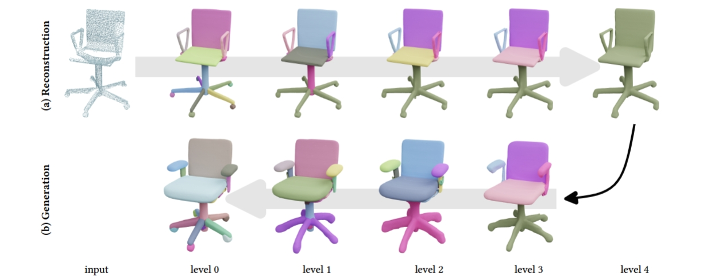

# StructRe: Rewriting for Structured Shape Modeling

### Transactions on Graphics
(presented at SIGGRAPH 2025)

In this paper, we propose a robust and generalizable approach for structured shape modeling, by using local and probabilistic structure rewriting. This approach presents a unified framework for structured reconstruction, completion and generation.




## [Project page](https://jiepengwang.github.io/StructRe/) |  [Paper](https://arxiv.org/abs/2311.17510)  |  [Model](https://www.modelscope.cn/models/wangjiepeng/StructRe)

## Code Overview

The implementation follows the three-stage StructRe pipeline:

1. **SparseVAE** encodes and decodes local part geometry with sparse 3D convolutions and KL-regularized latent codes.
2. **PartVAE** represents part arrangements in a unified structural latent space.
3. **StructMapping** performs iterative structure rewriting and coordinates the Stage 2 and Stage 1 decoders to produce hierarchical meshes.

The repository supports Stage 1-3 training, dataloader-backed validation, large-scale code extraction, and structured rewriting inference. Raw dataset preprocessing and the paper evaluation implementations are outside the public runtime; training starts from prepared model-facing artifacts.

## Installation

The reference software stack uses Python 3.12, PyTorch 2.9.1 with CUDA 12.8, MinkowskiEngine 0.5.4, and PyTorch3D 0.7.9. Install the platform and shared runtime packages with:

```bash
python -m pip install -r requirements/platform-cu128.txt
python -m pip install -r requirements/runtime.txt
```

MinkowskiEngine and PyTorch3D must be compiled against the active PyTorch and CUDA toolkit. Rebuild both extensions when changing PyTorch, CUDA, the compiler toolchain, or the target GPU architecture.

## Data and Paths

Dataset, checkpoint, experiment, and artifact locations are configured through `STRUCTRE_*` environment variables or CLI overrides. Common settings are:

```bash
export STRUCTRE_PARTNET_ROOT=/path/to/prepared-partnet-root
export STRUCTRE_EXPERIMENT_ROOT=/path/to/experiment-output-root
export STRUCTRE_STAGE1_ARTIFACT_ID=sparse-vae-chair
export STRUCTRE_STAGE2_ARTIFACT_ID=part-vae-chair
export STRUCTRE_STAGE1_CHECKPOINT=/path/to/sparse-vae-checkpoint.pth
export STRUCTRE_STAGE2_CHECKPOINT=/path/to/part-vae-checkpoint.pth
export STRUCTRE_STAGE3_CHECKPOINT=/path/to/structmapping-checkpoint.pth
```

Prepared inputs include TSDF and point-cloud HDF5 files, Stage 1 and Stage 2 code folders, validity manifests, and Stage 3 hierarchy-pair HDF5 files. Pretrained checkpoints and prepared datasets are not bundled with the source tree.

Checkpoint precedence is the stage-specific CLI argument, then the matching `STRUCTRE_STAGE*_CHECKPOINT` environment variable, then the repository-relative default.

Detailed guides: [environment](docs/environment.md), [path configuration](docs/configuration.md), and [training and inference](docs/training.md).

## Inspect Capabilities

The model pipelines and inference task contracts can be inspected without loading the ML or geometry runtime:

```bash
python exp_runner.py --describe_pipeline stage1
python exp_runner.py --describe_pipeline stage2
python exp_runner.py --describe_pipeline stage3
python exp_runner.py --list_inference_tasks
```

## Training and Inference

`exp_runner.py` is the unified public entry point:

| Mode | Purpose |
|---|---|
| `train` | Train SparseVAE, PartVAE, or StructMapping |
| `validate` | Run dataloader-backed model validation |
| `infer_code` | Extract Stage 1 patch codes or Stage 2 structure codes |
| `infer_rewriting` | Run the StructMapping rewriting tasks |

Example training commands:

```bash
python exp_runner.py --mode train --conf ./confs/sparse_vae.conf --exp_name sparse-vae-chair --category chair
python exp_runner.py --mode train --conf ./confs/part_vae.conf --exp_name part-vae-chair --category chair
python exp_runner.py --mode train --conf ./confs/structmapping.conf --exp_name structmapping-chair --category chair
```

Code extraction uses the trained Stage 1 or Stage 2 checkpoint:

```bash
python exp_runner.py --mode infer_code --conf ./confs/sparse_vae.conf --is_continue --path_ckpt "$STRUCTRE_STAGE1_CHECKPOINT" --category chair --sparse_vae_dataset_name partnet --sparse_vae_mode_shape shape_parts --extract_mode test
```

Common StructMapping inference tasks include:

| Task | Required input |
|---|---|
| `mesh_reconstruct` | Directory of normalized PLY meshes |
| `mesh_cycle` | PLY directory and part-code noise level |
| `completion` | JSONL manifest of partial point-cloud HDF5 files |
| `reconstruction` | JSONL manifest of categorized PLY meshes |
| `generation_noise_sweep` | Prepared source shapes and noise levels |
| `mesh_encode` | Directory of normalized PLY meshes |
| `test_mesh_uncond_gen` | Shape-code HDF5 produced by mesh encoding |
| `shape_code_interpolate` | Two compatible shape codes |

A custom-mesh reconstruction uses all three model checkpoints:

```bash
python exp_runner.py --mode infer_rewriting --conf ./confs/structmapping.conf --exp_name chair-reconstruction --is_continue --path_ckpt "$STRUCTRE_STAGE3_CHECKPOINT" --path_ckpt_stage1 "$STRUCTRE_STAGE1_CHECKPOINT" --path_ckpt_stage2 "$STRUCTRE_STAGE2_CHECKPOINT" --category chair --use_no_dataloader --should_load_sparse_vae --mapping_test_name_task mesh_reconstruct --mapping_input_mesh_dir /path/to/normalized-ply-directory --mapping_n_hier_infer 2
```

Run `python exp_runner.py --list_inference_tasks` for the complete task inventory, aliases, stage dependencies, and input/output contracts.

## Outputs

Training and inference outputs are written below `STRUCTRE_EXPERIMENT_ROOT`, which defaults to `exps/`. Rewriting tasks produce hierarchy trees, structured meshes, and intermediate codes in task-specific experiment directories.

## Repository Scope

- Raw PartNet and ShapeNet preprocessing producers are not included.
- Paper metric and benchmark evaluators are not included.
- CUDA extensions must be rebuilt for the active PyTorch, CUDA, compiler, and target architecture.
- Optional workflows may require additional geometry packages.

## License

This project is released under the [MIT License](LICENSE).


## Citation

Cite as below if you find this repository is helpful to your project:

```
@article{wang2023structre,
    title={StructRe: Rewriting for Structured Shape Modeling},
    author={Wang, Jiepeng and Pan, Hao and Liu, Yang and Tong, Xin and Komura, Taku and Wang, Wenping},
    journal={arXiv preprint arXiv:2311.17510},
    year={2023}
}
```

## Acknowledgements

We gratefully acknowledge the authors and contributors of
[AutoSDF](https://github.com/yccyenchicheng/AutoSDF),
[MinkowskiEngine](https://github.com/NVIDIA/MinkowskiEngine),
[DETR](https://github.com/facebookresearch/detr),
[StructureNet](https://github.com/daerduoCarey/structurenet), and
[BlenderToolBox](https://github.com/HTDerekLiu/BlenderToolbox) for making
their code and tools publicly available.
